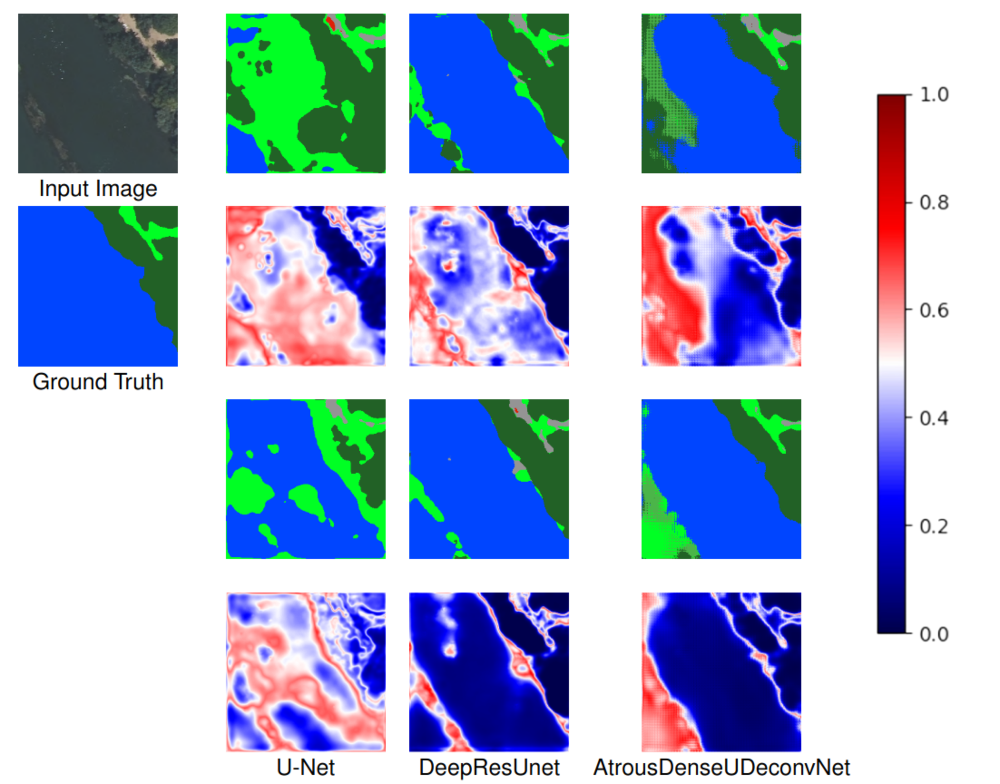

# SoftMax or Sigmoid

    

## Usage
Project developed using Python 3.10 and PyTorch 2.8.0.
### Generate Datasets

Datasets generated by dataset.py, the datasets are expected to be subdirectories of the dataset directory, generation is done according to the dataset.json file, example dataset.json files can be found in the respective dataset subdirectory.
### Commandline Arguments for main.py

SoftMax - 1 for SoftMax, 0 for Sigmoid

modelIndex - 0 for U-Net, 1 for Deep ResUnet, 2 for AtrousDenseUDeconvNet

datasetIndex - index for the dataset directories inside the dataset directory, alphabetically sorted

`--calibrationMode` - 0 for class-wise temperature scaling, 1 for normal temperature scaling

### Model checkpoints
Models are saved in subdirectories of the checkpoint folder, the name of the checkpoit folder can be configured in `main.py`. Each new execution of `main.py` will generate a new subdirectory in the models checkpoint folder, due to the library used to generate the checkpoints, PyTorch-Ignite, requiring that the directory that is saved to is empty.

### Results
Metrics will be saved after each training epoch to the `results.txt` file in the checkpoint directory of the model. 

Metrics of test runs are saved to the `metrics.txt` file in the checkpoint directory. 

Reliability diagrams are saved to the models checkpoint directory with the generation time as their name, the temperature used by the reliability diagram is appended to the `calibration.txt` file in the models checkpoint directory. 

Uncertainty plots are saved with the input image, ground truth label and class prediction to a directory that has the generation time as its name, within subdirectories sequentially named for each image in the test dataset.

## Datasets
##### International Society for Photogrammetry and Remote Sensing, 2015. [Potsdam Semantic Labeling Dataset](https://www.isprs.org/resources/datasets/benchmarks/UrbanSemLab/2d-sem-label-potsdam.aspx)
##### J. Xia, H. Chen, C. Broni-Bediako, Y. Wei, J. Song and N. Yokoya, "OpenEarthMap-SAR: A benchmark synthetic aperture radar dataset for global high-resolution land cover mapping \[Software and Data Sets\]," in IEEE Geoscience and Remote Sensing Magazine, vol. 13, no. 4, pp. 476-487, Dec. 2025, doi: 10.1109/MGRS.2025.3599512.
